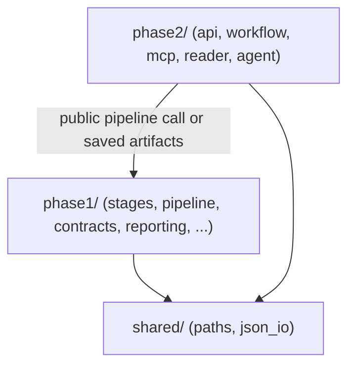

# Architecture

Authoritative map of the phase-separated layout. The approved intent lives in
[the design spec](superpowers/specs/2026-10-16-phase-layout-design.md); this page
is the navigation summary for a reviewer.

## Repository tree

```text
README.md                 # 5-minute on-ramp
pyproject.toml            # setuptools src/ packaging (deps from requirements.txt)
requirements.txt          # single source of package dependency metadata
src/document_compare/
  __main__.py             # `python -m document_compare` → phase1.pipeline.cli
  phase1/                 # comparison engine, all 15 stages
    stages/               # s01_extract … s15_serve
    pipeline/             # CLI, stage runner, generic-only mode
    extraction/           # DI field/page helpers
    structure/            # TOC, hierarchy, recurring furniture
    matching/             # reconciliation, language profile
    contracts/            # validation, review identity, outcome migration
    reporting/            # original/inline PDF, HTML, diff spans/annotations
    evaluation/           # optional benchmarks/diagnostics (off the runtime path)
  phase2/                 # API, workflow, MCP, reader, agent
    api/                  # HTTP service + operational summary
    workflow/             # local submit/poll/start/stop orchestration
    mcp/                  # workflow surface + three-tool reader surface
    reader/               # read-only result projection
    agent/                # planner/controller, tools, gateway, prompts, mock
  shared/                 # generic path and JSON I/O helpers only
tests/                    # phase1/, phase2/, integration/, support/, fixtures/
docs/                     # architecture, review-guide, contracts/, operations/, releases/
input/                    # private/runtime uploads (contents preserved)
workspace/                # generated runtime output (ignored, preserved)
```

## Dependency direction

One-way only: Phase 2 may call the Phase 1 public pipeline or read saved
artifacts; Phase 1 must never import Phase 2; `shared` imports neither phase.



Runtime engine code (Phase 1) must not depend on the optional `evaluation/`
tooling; the production `build_outcome_migration` helper lives in
`phase1/contracts/outcomes.py` and evaluation imports it.

## Stage map (s01–s15, all Phase 1)

Each stage reads a named artifact from the job root and writes the next one.

| Stage | File | Input | Output |
| --- | --- | --- | --- |
| s01 | `s01_extract.py` | two PDFs / DI API | raw DI JSON + extraction warnings |
| s02 | `s02_validate_extraction.py` | raw DI JSON | validation JSON |
| s03 | `s03_internal_schema.py` | validated DI | neutral internal document JSON |
| s04 | `s04_normalize.py` | document JSON | normalized JSON |
| s05 | `s05_anchors.py` | normalized JSON | structured JSON + `structure_evidence` |
| s06 | `s06_exact_matching.py` | structured pair | exact matches |
| s07 | `s07_modified_matching.py` | residual text | bounded modified matches |
| s08 | `s08_candidates.py` | matches | candidate/change list |
| s09 | `s09_movement.py` | candidates | movement-resegmented candidates |
| s10 | `s10_tables.py` | structured tables | table comparison records |
| s11 | `s11_routing.py` | candidates + tables | review routing |
| s12 | `s12_packets.py` | eligible routes | bounded review packets |
| s13 | `s13_llm_evaluator.py` | packets | mock/real decisions + trace |
| s14 | `s14_canonical_result.py` | all decisions | canonical result, review queue, CSV |
| s15 | `s15_serve.py` | canonical artifacts | HTML/PDF/manifest/index bundle |

Stage 15 is Phase 1 reporting, not Phase 2 logic. Its generated
`phase2_change_index.json` keeps that historical filename as an artifact
contract; the name does not mean Phase 2 imports it.

## Runtime flow

1. The Phase 2 API service (`phase2/api/service.py`) creates an isolated
   `workspace/jobs/<job_id>/` job and runs the Phase 1 pipeline
   (`phase1/pipeline`) over two uploaded PDFs.
2. Stages s01–s15 write `output/*.json` plus the PDF/HTML/CSV bundle; Stage 13
   uses the mock evaluator by default (`CRR_RUN_LLM=mock`).
3. The workflow MCP server (`phase2/mcp/workflow_server.py`) exposes
   submit/status/retrieve over HTTP to the local reviewer
   (`phase2/workflow/local_reviewer.py`).
4. The reader MCP server (`phase2/mcp/reader_server.py`) exposes exactly
   `summarize`, `search`, `details`, backed by the read-only projection in
   `phase2/reader/result_reader.py` over saved canonical artifacts.
5. The agent (`phase2/agent/`) plans only over those three reader tools; it does
   not download the full report and re-implement search.

Runtime config keys intentionally keep the legacy `CRR_` prefix even though the
old Python CLI is gone; the prefix is a preserved external contract, not a
compatibility shim.

This is a local pilot, not a production architecture lock. Production database,
authentication and shared deployment remain open decisions.
