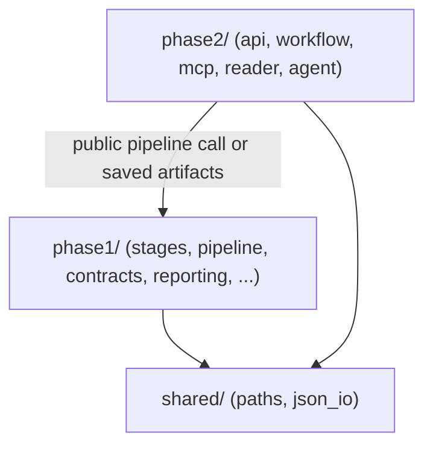

# Architecture

Authoritative map of the phase-separated layout. The approved intent lives in
[the design spec](superpowers/specs/2026-10-16-phase-layout-design.md); this page
is the navigation summary for a reviewer.

## Repository tree

```text
README.md                 # 5-minute on-ramp
pyproject.toml            # setuptools src/ packaging (deps from requirements.txt)
requirements.txt          # single source of package dependency metadata
src/document_compare/
  __main__.py             # `python -m document_compare` → phase1.pipeline.cli
  phase1/                 # comparison engine, all 15 stages
    stages/               # s01_extract … s15_serve
    pipeline/             # CLI, stage runner, generic-only mode
    extraction/           # DI field/page helpers + native PDF-outline prepass
    structure/            # TOC, hierarchy, recurring furniture, outline links
    matching/             # reconciliation, language profile
    contracts/            # validation, review identity, result-state, outcomes
    reporting/            # report model + original/inline PDF, HTML, diff spans
    evaluation/           # optional benchmarks/diagnostics + Gate B shadow (off runtime)
  phase2/                 # API, workflow, MCP, reader, agent
    api/                  # HTTP service + operational summary
    workflow/             # local submit/poll/start/stop orchestration
    mcp/                  # workflow surface + three-tool reader surface
    reader/               # read-only result projection
    agent/                # planner/controller, tools, gateway, prompts, mock
  shared/                 # generic path and JSON I/O helpers only
tests/                    # phase1/, phase2/, integration/, support/, fixtures/
docs/                     # architecture, review-guide, contracts/, operations/, releases/
input/                    # private/runtime uploads (contents preserved)
workspace/                # generated runtime output (ignored, preserved)
```

## Dependency direction

One-way only: Phase 2 may call the Phase 1 public pipeline or read saved
artifacts; Phase 1 must never import Phase 2; `shared` imports neither phase.



Runtime engine code (Phase 1) must not depend on the optional `evaluation/`
tooling; the production `build_outcome_migration` helper lives in
`phase1/contracts/outcomes.py` and evaluation imports it.

Gate B shadow evaluation (`evaluation/semantic_shadow*.py`) is also off the
runtime path. It runs only through an explicit local CLI and local model
directory; its optional ML import is lazy, it has no HTTP/service endpoint and
no package dependency. Every output row is advisory (`basis=model_advisory`,
`authority=false`); it never changes Stage 13/14 dispositions, canonical status,
IDs or reader output. Protected source facts and explicit abstention remain the
safety boundary.

## Stage map (s01–s15, all Phase 1)

Artifacts live under `<workspace>/output/`. The stages are deliberately separate:
extraction quality, structural hypotheses, matching, review and presentation must
not silently overwrite one another's evidence. Later stages often consume more
than the immediately previous artifact.

| Stage | File | Purpose / why it exists | Input | Output |
| --- | --- | --- | --- | --- |
| s01 | `s01_extract.py` | Turn PDFs into machine-readable text, tables and locations; cache chunks so extraction can resume without repeating successful provider work. Collects optional, source-bound native outline sidecars before DI. | two PDFs / DI cache or API | raw DI JSON + outline sidecars + extraction warnings |
| s02 | `s02_validate_extraction.py` | Detect broken page/span/table/geometry/confidence evidence before treating extraction noise as document changes; optionally cross-check native PDF text. | raw DI JSON | validation JSON |
| s03 | `s03_internal_schema.py` | Isolate downstream comparison from the DI response shape using stable element IDs while preserving source text, locations and validation evidence. Carries the Stage-1 extraction source identity. | DI + validation | neutral internal document JSON |
| s04 | `s04_normalize.py` | Reduce conservative Unicode/whitespace/wrap noise without rewriting raw text or meaningful quantitative differences. | document JSON | normalized JSON |
| s05 | `s05_anchors.py` | Supply provisional heading context and additive TOC/outline/section evidence, distinguishing recurring page furniture from body content. Verified native outline links are preferred evidence; absence or staleness falls back to reconstruction. These are hypotheses, not authoritative hierarchy. | normalized JSON + outline sidecars | structured JSON + `structure_evidence` |
| s06 | `s06_exact_matching.py` | Remove confidently unchanged pairs first; use provisional context to disambiguate repeated identical text where supported. | structured pair | exact matches |
| s07 | `s07_modified_matching.py` | Find supported modified pairs among residuals rather than reporting every edit as unrelated deletion/addition. Attach only complete deterministic source witnesses; a short-text-only review may be nominated for clearing later. | structured pair + exact-match residuals | bounded modified matches + optional `semantic_assessment` |
| s08 | `s08_candidates.py` | Assemble paired/unpaired candidates and token diffs while conserving all old/new elements and keeping uncertain duplicate matches visible. | exact + modified matches | candidate/change list |
| s09 | `s09_movement.py` | Distinguish relocation and split/merge/resegmentation evidence from ordinary edits, without hiding genuine content changes. Record bounded plausible residual counterparts and explicit examined/unsearched coverage; proposals never consume candidates. | candidates | movement-resegmented candidates + `residual_proposals`/groups/coverage |
| s10 | `s10_tables.py` | Compare logical tables across physical page continuations and align rows/cells, preserving unresolved table evidence. | structured pair + movement candidates | table comparison records |
| s11 | `s11_routing.py` | Decide deterministically which cases are supported and which remain uncertain or eligible for optional advisory evaluation; no domain-specific verifier. Plausible residual counterparts or incomplete search coverage block absence-based add/delete acceptance. | candidates + tables | routing with `UNCERTAIN_RESULT` |
| s12 | `s12_packets.py` | Package only eligible cases into bounded old/new evidence for optional evaluation, not an unbounded document upload. | eligible routes + evidence | bounded review packets |
| s13 | `s13_llm_evaluator.py` | Obtain optional advisory `REAL_CHANGE` / `ARTIFACT` / `UNCERTAIN` recommendations with traceability; mock mode exercises the contract without model calls. | packets | disabled/mock/real decisions + trace |
| s14 | `s14_canonical_result.py` | Produce the single canonical result using deterministic resolution rules; preserve LLM advice without letting it approve or suppress changes. Independently revalidates semantic witnesses and emits one grouped explanation for a residual proposal group while keeping every member record. Adds normalized `result_state` while retaining legacy status fields. | routing + candidate/table/evaluation evidence | canonical result + review queue |
| s15 | `s15_serve.py` | Present/export the canonical result for human inspection and downstream reading without recomputing matching; primary HTML/PDF use canonical records, not an accepted-only projection. | canonical + structured artifacts | complete HTML/PDF/CSV/manifest/index bundle |

Stage 15 is Phase 1 reporting, not Phase 2 logic. Its generated
`phase2_change_index.json` keeps that historical filename as an artifact
contract; the name does not mean Phase 2 imports it.

### Stage 5: anchors, TOC and page furniture

An **anchor** is a provisional heading landmark used as comparison context.
`structure_evidence` separately records TOC entries, candidate body-heading
links, sections, uncertainty, and one membership category per element (`toc`,
`layout`, `section`, `preamble`, `uncertain`). Neither layer grants authoritative
semantic hierarchy or changes raw extraction roles, text or IDs.

**Derived furniture** means recurring headers/footers supported jointly by
repeated text, layout-role occurrences on multiple pages, and page-edge geometry.
A single DI role or repetition alone is insufficient. The same classification
is shared by anchor and structure reconstruction. Furniture is excluded from
TOC heading/entry/table-source detection and skipped while scanning between TOC
pages; it must not terminate continuation or create a fake heading. Its membership
is always `layout`. The validator still rejects contradictory evidence.

This matters for the reported EBA STEP2 failure: the old TOC-first membership
could classify a recurring `Contents` header as `toc`, contradicting the furniture
invariant. Synthetic regressions reproduce that exact error plus interrupted
text/table TOCs; verification on the private EBA artifacts is a separate step.

### Stage 5: native outline evidence and fallback

Stage 1 reads embedded PDF bookmarks locally with PyMuPDF before any DI request
and writes versioned `output/old_pdf_outline.json` / `new_pdf_outline.json`
sidecars. Each records the source PDF SHA-256, physical page count, acquisition
status (`available`, `partial`, `absent`, `invalid`, `read_failure`), validated
entries and diagnostics. Entries keep source order, level, title, physical page,
separate page label and destination evidence; they never invent DI element IDs.
A printed contents page is not an embedded outline, and the prepass does not add
a second OCR/TOC detector.

Binding is to PDF bytes, not a filename. Stage 1 carries a `source_binding` into
the merged raw model; Stage 3 stores it as
`document.source.extraction_source`; Stage 5 consumes a sidecar only when its
SHA-256 and physical page count still match. A missing identity, stale sidecar,
malformed file or unsupported version yields no outline evidence and the existing
reconstruction path. Invalid, external or out-of-bounds destinations remain
diagnostics rather than headings. An outline-read failure does not abort valid
DI extraction; a genuine PDF/extraction failure still follows existing failure
behavior. Source PDFs remain at their external `CRR_OLD_PDF` / `CRR_NEW_PDF`
paths.

Stage 5 links an entry to a body element only on exact canonical title **and**
physical page, excluding layout, table, ineligible, furniture and contents-heading
elements. Conflicting pages, duplicate titles and duplicate links stay
`unmatched`/`ambiguous` with a reason. Supported links add a
`structure_evidence.outline` block and `pdf_outline_heading` anchor support;
outline-backed sections are preferred and printed-TOC/body inference fills
uncovered regions. Derived furniture is never promoted, uncovered body content is
not suppressed, and a usable outline is still not authoritative hierarchy.
Legacy `structure_evidence` versions `1.1.x` remain readable.

## Runtime flow

1. The Phase 2 API service (`phase2/api/service.py`) creates an isolated
   `workspace/jobs/<job_id>/` job and runs the Phase 1 pipeline
   (`phase1/pipeline`) over two uploaded PDFs.
2. Stages s01–s15 write `output/*.json` plus the PDF/HTML/CSV bundle; Stage 13
   uses the mock evaluator by default (`CRR_RUN_LLM=mock`).
3. The workflow MCP server (`phase2/mcp/workflow_server.py`) exposes
   submit/status/retrieve over HTTP to the local reviewer
   (`phase2/workflow/local_reviewer.py`).
4. The reader MCP server (`phase2/mcp/reader_server.py`) exposes exactly
   `summarize`, `search`, `details`, backed by the read-only projection in
   `phase2/reader/result_reader.py` over saved canonical artifacts. It reports
   normalized `supported`/`uncertain`/`non_semantic` state while keeping legacy
   review fields readable.
5. The agent (`phase2/agent/`) plans only over those three reader tools; it does
   not download the full report and re-implement search.

### Selecting phases and saved workspaces

Phase 1 is all 15 comparison/reporting stages; Phase 2 is reader/API/MCP/agent
interaction, not stages 8–15. Stage 13's optional evaluator is not the Phase 2
chat model. `CRR_RUN_LLM=mock` does not make interactive chat offline.

The local reviewer accepts `--phase phase1|phase2|both --workspace PATH`:

- `phase1`: run the engine only, writing into the selected workspace.
- `phase2`: read one completed workspace in place, with a local gateway over
  the same bounded `result_reader` used by HTTP. No extraction, API registration,
  source mutation or copying. `--check-only` needs no credentials/model calls.
- `both`: run Phase 1, then local saved-workspace chat on that exact result.
- No flags: retain the existing PDF-selection → API/workflow MCP → reader MCP
  → chat flow above. Explicit saved mode does **not** test HTTP/MCP transport.

Explicit `--workspace` overrides `CRR_PROJECT_ROOT`; explicit phase modes otherwise
use that environment setting, then `<repo>/workspace`. Select the directory
containing `output/`, not `output/` itself. A completed canonical result is
required; an explicit unfinished/failed job status is rejected. Optional missing
structured context/extraction validation is reported as a limitation, never
invented. Malformed present artifacts are rejected. The gateway pins an in-memory
snapshot to one job identity for the chat session; rerun to load updated artifacts.
See [phase testing](operations/phase-testing.md) for commands and acceptance checks.

Runtime config keys intentionally keep the legacy `CRR_` prefix even though the
old Python CLI is gone; the prefix is a preserved external contract, not a
compatibility shim.

This is a local pilot, not a production architecture lock. Production database,
authentication and shared deployment remain open decisions.
