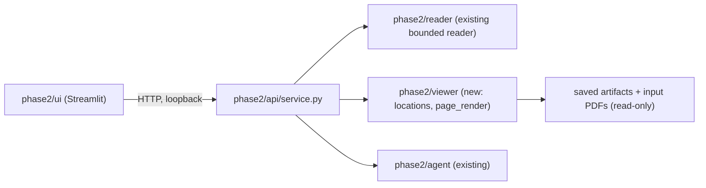

# Compare frontend (Phase 2) — design

Status: IMPLEMENTED (2026-11-11, offline-verified only). Prepared: 2026-11-11.
Verified: automated offline tests and one manual browser check on a seeded synthetic
job (highlights landed on the changed text for a modified and a deleted finding).
Not verified: highlight accuracy on real PDFs (rotation, crop boxes) and live chat.
Corrections made at implementation time: sections 5.1-5.3, 8 and the error shape below.
Reference behaviour: Adobe Acrobat "Compare Files" (side-by-side old/new pages,
a list of changes, selecting a change shows it highlighted on both sides).

## 1. Goal

Give a reviewer one local web page where they can upload an old and a new PDF,
watch the comparison run, review every finding on the original pages side by
side, and ask questions about the saved result.

Success for version 1:

- A reviewer can go from two PDFs to a highlighted finding without the command line.
- Selecting a finding shows the correct old and new page with its region outlined.
- Uncertain findings are always visible and marked as uncertain.
- The whole flow can be developed and tested offline with synthetic data.

## 2. Decisions (accepted by the user)

| # | Decision |
| --- | --- |
| D1 | Scope is upload + viewer + chat. |
| D2 | The frontend is Streamlit, not React. |
| D3 | The viewer shows one old/new page pair at a time. Navigation is from the findings list. |
| D4 | Pages are rendered to images on the server with PyMuPDF. PDF.js is not used. |
| D5 | Streamlit is a client of the existing loopback HTTP API. It does not import the engine or read workspaces from disk. |
| D6 | Phase 1 is not changed. |

## 3. Non-goals for version 1

- Continuous or synchronized scrolling.
- Clicking a highlight on the page to select its finding.
- Word-level highlights inside a paragraph. The saved location is one polygon per element.
- Authentication, multi-user use, or any non-loopback exposure.
- Editing, approving or suppressing findings. The UI is read-only over the result.
- A jobs-list endpoint. A job is opened by its ID or from the current browser session.

## 4. Known facts (verified in the code on 2026-11-11)

- `phase2/api/service.py` already provides `POST /jobs`, job status with
  `stages_completed`, and the bounded reader at `/jobs/{id}/read/summary|search|details`.
- Uploaded PDFs are stored at `<job>/input/document/old.pdf` and `new.pdf`.
- The API serves neither source PDFs nor polygons today.
- `old_document.json` / `new_document.json` carry, per page, `width`, `height`,
  `unit` and `angle`; per element, `bounding_regions` with `page_number` and an
  8-number `polygon`, plus `primary_page` and `primary_polygon`.
- A change record names its elements by `old.element_id` / `new.element_id`.
- Table cell changes carry `primary_page`; `primary_polygon` may be `null`.
- The chat agent is `TiaComparisonAgent(tia, gateway).ask(question, job_id)`.
  `SavedWorkspaceGateway` is an in-process gateway over the bounded reader.
  Chat uses the internal hub client (`TiaTextClient`) only. The `openai_compatible`
  provider is not wired into the agent, so it is not available to chat.
- Every folder under `src/`, `tests/` and `docs/` must contain a `README.md`.

## 5. Architecture



Dependency direction is unchanged: `phase2/ui` depends only on HTTP;
`phase2/viewer` reads saved artifacts and may use `shared`; nothing in Phase 1
imports either.

### 5.1 New package `phase2/viewer/`

Two small modules, each a pure function over saved files.

**`locations.py`** — `resolve_locations(job_root, kind, record_id) -> dict`

- Looks up the record in the canonical result, then its elements in
  `old_document.json` / `new_document.json`.
- Returns, per side, a list of regions: `page_number`, the polygon normalized to
  0–1 by that page's `width` and `height`, and the page count.
- Normalizing by page size makes the output independent of the unit.
- For a table change, it returns the changed cells' polygons. A cell without a
  polygon falls back to the regions of elements whose `represented_by_table_id`
  equals the cell's `source_table_id`, limited to the cell's `primary_page`; if
  none, to page only.
- A review-queue record has no element reference, so both sides are
  `unavailable` and the UI shows its text only.
- A side with no element (the old side of an addition, the new side of a
  deletion) returns `regions: []` and `counterpart: "none"`.
- It never invents a location. A missing polygon is reported as
  `location: "page_only"` or `"unavailable"`.

**`page_render.py`** — `render_page(pdf_path, page_number, regions, style, scale) -> bytes`

- Renders one page to PNG with PyMuPDF and draws each normalized polygon as an
  outline with a translucent fill.
- `scale` is bounded (default 1.5, range 0.5–3.0). Page number is bounds-checked.
- Page rotation is honoured using the page's own rotation, verified by a test
  with a rotated synthetic page.
- It opens the PDF read-only and writes nothing.

### 5.2 New API endpoints (additive, read-only except chat's model call)

| Endpoint | Returns |
| --- | --- |
| `GET /jobs/{id}/view/locations?kind=&record_id=` | Output of `resolve_locations`. |
| `GET /jobs/{id}/view/pages/{side}/{page}.png?kind=&record_id=&scale=` | PNG of that page; with `kind` and `record_id`, the finding's regions on that page are highlighted. |
| `POST /jobs/{id}/chat` with `{"question": "..."}` | `{"answer": "...", "limitations": [...]}` from the existing agent. |

Rules:

- `side` is `old` or `new`. IDs are validated with the reader's existing validators.
- Errors reuse the reader's status mapping and shape,
  `{"detail": {"error": "<code>", "message": "..."}}`: unknown job or record 404,
  job not complete 409, bad arguments 422.
- A job with no stored source PDF returns 404 with code `source_pdf_unavailable`.
- A failure while answering returns 502 with code `chat_failed`.
- Chat builds the agent with `SavedWorkspaceGateway` for that job, so it only
  ever uses `summarize`, `search` and `details`. The existing ten-turn budget applies.
- Chat is configured when `TIA_API_KEY` and `LLM_MODEL` are both set; otherwise it
  returns 503 with code `chat_not_configured`. No new environment key is added.
- Contract: [view-endpoints](../contracts/view-endpoints.md).
- Existing endpoints, artifacts and `CRR_` keys are unchanged.

### 5.3 New package `phase2/ui/` (Streamlit)

One app, `app.py`, with helper modules `review.py` (findings list and page
viewer), `chat.py` (sidebar chat) and `api_client.py` (httpx calls to
`CRR_API_BASE`). Session state keys are `job_id`, `selected`, `old_page`,
`new_page`, `chat_history`. Three areas:

**Upload**

- Two file pickers labelled Old and New, and a Compare button.
- Submits to `POST /jobs` with a generated session ID.
- Polls status and shows progress as completed stages out of 15.
- A failed job shows the API's error text and keeps the job ID.
- An "Open existing job" field accepts a job ID.

**Review**

- Header from `read/summary`: document names, page counts, counts by type and
  by supported / uncertain / non-semantic, and the result's limitations.
- Findings list from `read/search`, using its cursor pagination. Filters: kind,
  change type, state, and a text query.
- Each row shows type, state, pages and a short snippet. Uncertain rows are
  marked and are never hidden by default.
- Previous / Next step through the filtered list.
- Selecting a finding shows the old page on the left and the new page on the
  right, each from the page PNG endpoint with highlights.
- Under the pages: old and new text from `read/details`, and the reasons when
  the finding is uncertain.
- Page controls let the reviewer move each side one page at a time.
- A side with no counterpart shows the same page number, clamped to the page
  count, with the note "No counterpart on this side".
- When the source PDF is unavailable, the pages are replaced by the old/new
  text side by side with a notice.

**Chat**

- A side panel using Streamlit's chat widgets, bound to the open job.
- Sends each question to `POST /jobs/{id}/chat`. History lives in session state only.
- When chat is not configured, the panel says so and the rest of the UI works.
- The panel carries the reader's notice that the result is not legal or semantic ground truth.

### 5.4 Highlight style

| Finding | Old side | New side |
| --- | --- | --- |
| Deleted | Red | — |
| Added | — | Green |
| Modified / table cell | Amber | Amber |
| Uncertain (any type) | Same colour, dashed outline | Same colour, dashed outline |

Colour is never the only signal: the type and state are always shown as text
next to the pages.

## 6. Run

```bash
python -m pip install -e ".[ui]"
python -m uvicorn document_compare.phase2.api.service:app --host 127.0.0.1 --port 8321
python -m streamlit run src/document_compare/phase2/ui/app.py
```

- `streamlit` is an optional extra named `ui`; the base install is unchanged.
- Both servers bind to loopback only. The checked-in `.streamlit/config.toml` sets
  the loopback address, disables usage statistics so no telemetry leaves the
  machine, and caps uploads at 50 MB.
- The uvicorn target and port match the existing API start-up command.

## 7. Confidentiality and authority boundaries

- The UI and new endpoints only read saved results; they never rerun the engine
  on an existing job or change a workspace.
- Real uploads still trigger Stage 1 extraction through the configured provider.
  The upload area states this before the Compare button.
- A real chat question sends bounded reader output to the configured model. The
  chat panel states this. No provider call is made in tests.
- Page images and result text are not logged.
- Stage 14 remains the authority. The UI shows Stage 13 advice only as the
  reader already reports it.

## 8. Offline development and testing

Real extraction needs an internal endpoint, and the bundled demo has polygons
but no PDFs. So:

- **`phase2/viewer/synthetic.py`** builds an old and a new PDF from a demo run's
  document JSON by drawing each element's text inside its polygon. It lives in
  `src/` (precedent: `phase2/agent/mock_reader.py`) so the seeding command can
  use it. The PDFs are generated, not committed.
- The same module seeds a complete job (demo artifacts plus the two synthetic
  PDFs) for manual UI work:
  `python -m document_compare.phase2.viewer.synthetic --jobs-root workspace/jobs`
  prints the demo logs; the job ID is the last line.

Tests, all offline:

| Test file | Proves |
| --- | --- |
| `tests/phase2/test_viewer_locations.py` | Modified, added, deleted and table findings resolve to the right pages and normalized polygons; missing polygons degrade as specified; unknown IDs are rejected. |
| `tests/phase2/test_page_render.py` | A pixel inside the polygon carries the highlight and a pixel outside does not; rotated page; out-of-range page and scale rejected. |
| `tests/phase2/test_view_api.py` | The three endpoints' success and error codes; chat with a scripted planner uses only the three reader tools; chat unconfigured returns 503. |
| `tests/phase2/test_viewer_synthetic.py` | The builder and seeding produce a readable job without touching existing jobs. |
| `tests/phase2/test_ui_client.py` | The HTTP client maps responses and errors; no network. |
| `tests/phase2/test_ui_smoke.py` | The app loads, lists findings and selects one, using Streamlit's `AppTest` against a stubbed API client. Skipped when Streamlit is not installed. |
| existing `tests/integration/test_architecture.py` | New folders have READMEs and Phase 1 still does not import Phase 2. |

Automated tests do not prove visual quality. A manual browser check of the
seeded job is part of acceptance.

## 9. Documentation impact

| Document | Change |
| --- | --- |
| Root README | New "Review in the browser" command section. |
| `docs/architecture.md` | `phase2/viewer` and `phase2/ui` in the tree and runtime flow. |
| `docs/contracts/` | New contract page for the three endpoints. |
| `docs/operations/phase-testing.md` | Offline UI check with the seeded job. |
| `docs/review-guide.md` | Owners and focused tests for the new packages. |
| Knowledge Transfer Phase 1 | No change; Phase 1 is untouched. |

## 10. Risks

- **Coordinate mapping on real PDFs.** Normalized polygons assume the extraction
  page size matches the PDF page box. This holds for synthetic data and is
  unverified on real documents with rotation or crop boxes. It needs one check
  on the work machine with approved documents.
- **Streamlit reruns.** Every interaction reruns the script. Page images and
  API reads are cached per job and finding to keep navigation responsive.
- **Large documents.** The findings list relies on the reader's pagination; the
  UI never loads the full report.
- **Chat latency.** A question can take up to ten model turns. The panel shows
  a waiting state and reports a budget error as the agent returns it.
